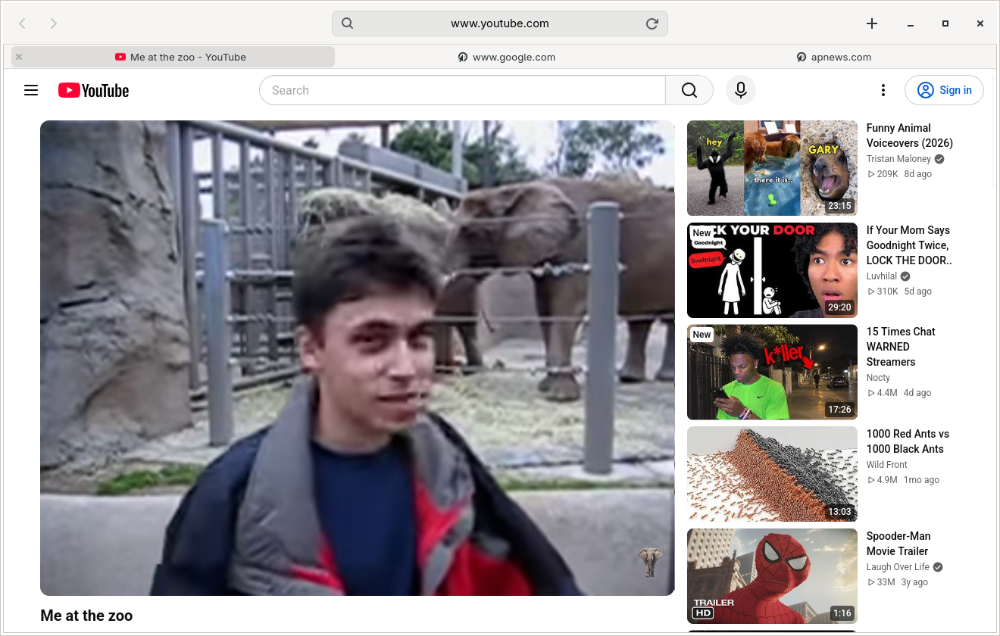
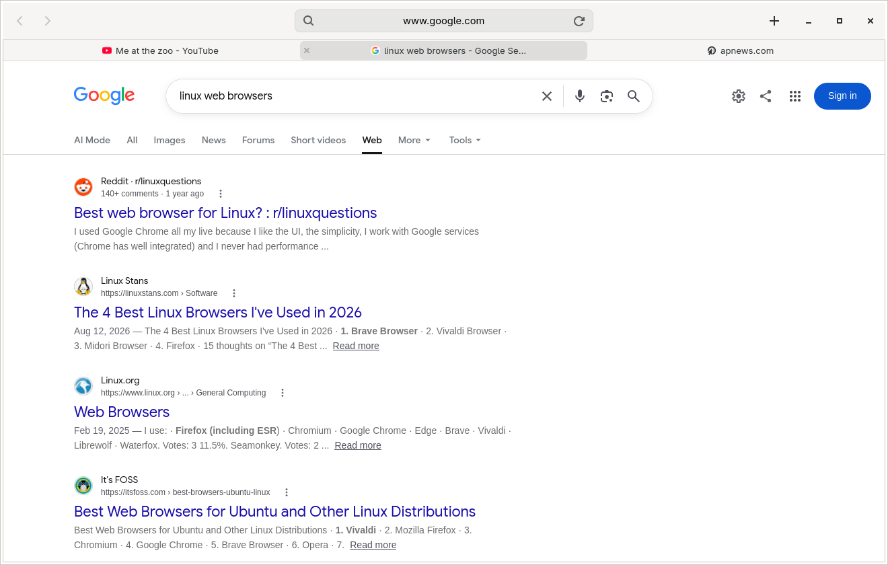
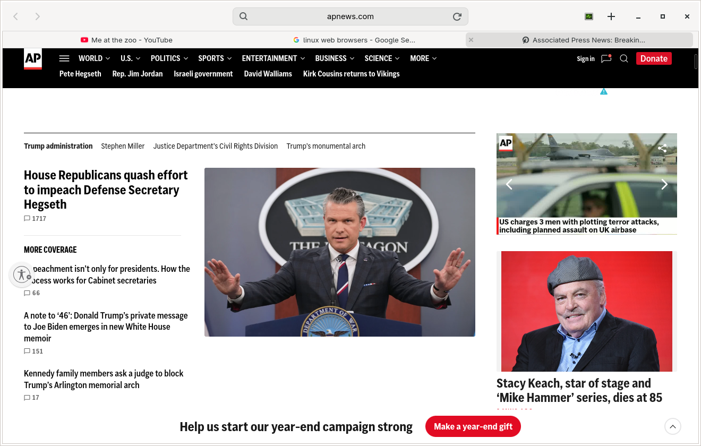
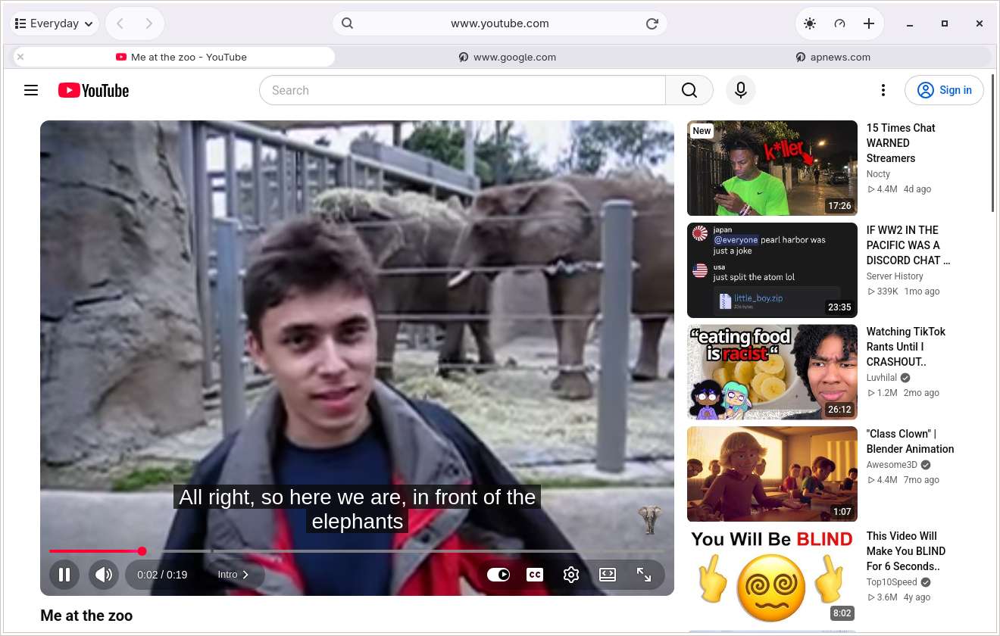
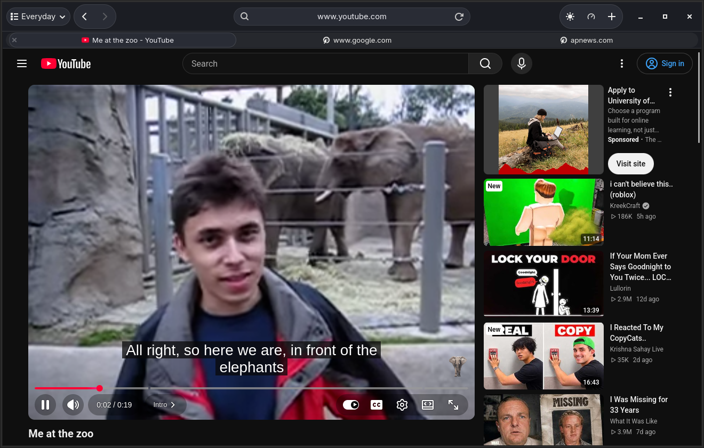

# Tillwind

Tillwind is a lightweight, Safari-inspired browser for Linux. Its Rust and GTK 4 interface pairs a centered address field with a separate tab strip. WebKitGTK renders pages.



## Features

- **Address and search in one field.** The field shows the site’s hostname while you browse and the full URL when you focus it. Enter a URL to navigate or type a search to send it to DuckDuckGo.
- **Separate tab strip.** Tabs show page titles and site icons when available. Drag tabs to reorder them, close them from the left side of the tab, or use the keyboard to switch among the first nine.
- **Tab groups.** Open the group menu or press Ctrl+Shift+G. Create a named group from the current tab, move tabs between groups, rename groups, and remove a group while keeping its tabs in Ungrouped. Tillwind remembers groups and their membership when you close the window.
- **Appearance.** Choose System, Light, or Dark from the appearance menu. The choice is saved with your session and updates the color-scheme preference exposed to websites that support it.
- **Navigation controls.** Go back or forward from the toolbar and reload from the address field.
- **Lazy session restore.** Tillwind saves the tab URLs, their order, and the selected tab on normal window close. At startup it loads the selected tab first and opens each background page when you select its tab. Session restore saves URLs only. Page history and unsaved form entries are outside the saved session.
- **Performance sidebar.** Open the monitor from the toolbar or press Ctrl+Shift+P. The translucent sidebar overlays the selected page without resizing it, shows CPU and resident memory history for its main WebKit renderer, and lists Tillwind and any shared WebKit network or GPU processes separately. The overlay lists the host CPU model and detected graphics adapters. The GPU panel reports the busiest measured engine for the tab renderer and shared browser processes when Linux DRM counters are available. Hover over the readings for engine details. Install the optional `pciutils` package for PCI GPU model names. The process table includes PID, CPU, resident memory, and thread count. When the main page exposes an HTML video, the sidebar also shows resolution, buffered time, and dropped frames. Sampling pauses when the sidebar is closed.
- **Autoplay protection and tab recovery.** Tillwind denies automatic media playback. If a page’s WebKit process stops, the affected tab offers a Reload Page button.

## Screenshots

| Google Search | AP News |
| --- | --- |
|  |  |

### Light and dark appearance

| Light | Dark |
| --- | --- |
|  |  |

## Run on Linux

Install a current stable Rust toolchain, a C toolchain, `pkg-config`, GTK 4.10 or later, and the WebKitGTK 6.0 development libraries.

- **Arch Linux** — `base-devel`, `gtk4`, and `webkitgtk-6.0`. Install `gst-plugins-good` for WebM/VP8 playback on minimal installations.
- **Debian-based distributions with WebKitGTK 6.0** — `build-essential`, `pkg-config`, `libgtk-4-dev`, and `libwebkitgtk-6.0-dev`.

From the repository directory, run:

```sh
cargo run --release --locked
```

### Keyboard shortcuts

| Shortcut | Action |
| --- | --- |
| Ctrl+L | Focus the address field and select the URL |
| Ctrl+T | Open a new tab |
| Ctrl+W | Close the current tab |
| Ctrl+R | Reload the current page |
| Ctrl+1–9 | Select a tab by position within the active group |
| Ctrl+Shift+G | Open Tab Groups |
| Ctrl+Shift+P | Show or hide the performance sidebar |

## Testing

The GitHub Actions Linux build checks Rust formatting and builds against GTK and WebKitGTK. Desktop UI and media playback need a separate smoke test.

1. Start `python3 -m http.server 8000 --bind 127.0.0.1` in a scratch directory. Open three tabs at `http://127.0.0.1:8000/?tab=1`, `http://127.0.0.1:8000/?tab=2`, and `http://127.0.0.1:8000/?tab=3`. Select tab 2, close the window, and relaunch. The server should receive the request for tab 2 first. Requests for tabs 1 and 3 should arrive when you select them.
2. For a playback comparison, use the same clip, codec, resolution, and frame rate in both browsers. Record the decoder, total browser CPU use, and dropped frames. Playback formats and hardware decoding depend on the installed WebKitGTK and GStreamer stack.
3. Repeat a fixed tab open-and-close sequence. Compare proportional memory (PSS) after each batch has settled and compare idle CPU before and after playback.

The performance sidebar reports process-level CPU and resident memory (RSS). When WebKit shares a renderer between pages, those figures cover the whole renderer. The process table’s GPU row, when present, shows the GPU process’s CPU and RSS. The separate GPU panel uses DRM engine counters. Drivers that omit those counters and processes whose descriptors cannot be read produce an unavailable reading.

Tillwind is a development prototype. The Arch smoke test covered lazy restore, tab reordering, keyboard shortcuts, and software VP8 playback on an isolated X11 display. Native Wayland playback and hardware decoding are still unverified.
